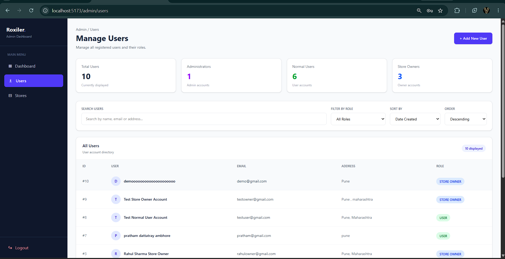
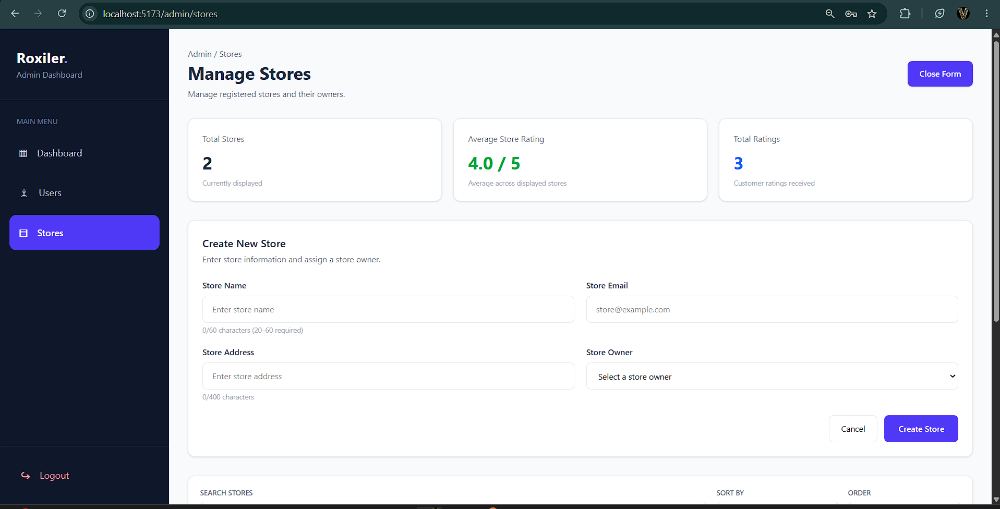
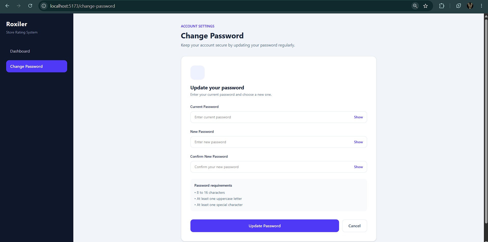

# Roxiler Store Rating System


A full-stack web application designed for role-based store management and customer rating tracking. The platform enables administrators to oversee users and stores, normal users to discover and rate stores, and store owners to monitor rating performance and customer feedback.

---

## Table of Contents

- [Project Overview](#project-overview)
- [Technology Stack](#technology-stack)
- [Key Features](#key-features)
- [Database Overview](#database-overview)
- [Project Structure](#project-structure)
- [Application Screenshots](#application-screenshots)
- [Installation and Setup](#installation-and-setup)
- [Author](#author)

---

## Project Overview

The **Roxiler Store Rating System** implements a structured, three-tier access control architecture tailored to distinct operational roles:

- **Administrators** maintain platform governance by adding and managing users, creating and managing stores, assigning user roles, and reviewing platform-wide statistics.
- **Normal Users** can register for an account, search and explore registered stores, view aggregated rating scores, and submit or update ratings on a 1-to-5 scale.
- **Store Owners** have access to a dedicated dashboard displaying their store's average rating, total rating count, and individual customer rating details.

---

## Technology Stack

| Layer | Technologies |
| :--- | :--- |
| **Frontend** | React.js, Vite, Tailwind CSS, Axios, React Router DOM |
| **Backend** | Node.js, Express.js, Prisma ORM |
| **Database** | MySQL |
| **Security & Auth** | JSON Web Tokens (JWT via HTTP-only cookies), bcrypt |

---

## Key Features

### Administrator
- View platform statistics from the Admin Dashboard.
- Add, view, and manage user accounts across roles.
- Create, view, and manage registered stores.
- Search, filter, and sort user and store records.
- Assign and manage user roles.

### Normal User
- Register a new user account and log in securely.
- Browse all available stores and view their average ratings.
- Search stores by name and address.
- Submit store ratings on a scale from 1 to 5.
- Update previously submitted ratings.
- Update account password.

### Store Owner
- Access a dedicated Store Owner Dashboard.
- View the overall average rating for their store.
- Track the total number of customer ratings received.
- Inspect detailed customer rating submissions.
- Update account password.

### Authentication and Security
- **Stateless Authentication:** JWT-based authentication stored in secure HTTP-only cookies.
- **Role-Based Access Control (RBAC):** Strict authorization middleware separating Admin, Normal User, and Store Owner endpoints and UI views.
- **Credential Protection:** Password hashing using `bcrypt` prior to database persistence.
- **Route Protection:** Client-side and server-side protected routes with secure logout functionality.

---

## Database Overview

The relational data layer is managed using **MySQL** and **Prisma ORM**, structured around three core entities:

- **Users:** Stores user profile details, hashed passwords, and assigned roles (`Admin`, `Normal User`, `Store Owner`).
- **Stores:** Stores business information (such as store name, email, and address) linked to a designated Store Owner.
- **Ratings:** Records individual user rating scores (1–5) associated with both the submitting user and the target store, enabling real-time average rating calculations.

---

## Project Structure

```text
roxiler_system/
├── backend/          # Express.js REST API, Prisma schema, controllers, and auth middleware
├── frontend/         # React + Vite client application, Tailwind styles, and role-based views
├── screenshots/      # Application interface previews
├── .gitignore        # Git ignore rules
└── README.md         # Project documentation
```

---

## Application Screenshots

### Admin Views

| Admin Manage Users | Admin Manage Stores |
| :---: | :---: |
|  |  |

| Create Store |
| :---: |
|  |

---

### Normal User Views

| User Registration | User Explore Stores |
| :---: | :---: |
|  |  |

| Change Password |
| :---: |
|  |

---

### Store Owner Views

| Store Owner Dashboard |
| :---: |
|  |

---

## Installation and Setup

### Prerequisites
- Node.js (v18+ recommended)
- npm
- MySQL Server

### 1. Clone the Repository

```bash
git clone [https://github.com/vaish12345678/roxiler_system.git](https://github.com/vaish12345678/roxiler_system.git)
cd roxiler_system
```

### 2. Backend Setup

Navigate to the backend directory and install dependencies:

```bash
cd backend
npm install
```

Create a `.env` file inside the `backend/` directory and configure the following environment variables:

```env
DATABASE_URL="YOUR_MYSQL_DATABASE_URL"
JWT_SECRET="YOUR_SECRET_KEY"
```

Generate the Prisma Client:

```bash
npx prisma generate
```

> **Note:** Apply your database schema/migrations according to your local setup before starting the server (confirm migration command in `backend/package.json`, e.g., `npx prisma migrate dev` or `npx prisma db push`).

Start the backend server (confirm the exact start script in `backend/package.json`, e.g., `npm run dev` or `npm start`):

```bash
npm run dev
```

The backend API will run at: `http://localhost:5000`

### 3. Frontend Setup

Open a new terminal, navigate to the frontend directory, and install dependencies:

```bash
cd frontend
npm install
```

Start the Vite development server (confirm script in `frontend/package.json` if customized):

```bash
npm run dev
```

The frontend application will run at: `http://localhost:5173`

---

## Author

**Vaishnavi Ambhore**  
GitHub: [@vaish12345678](https://github.com/vaish12345678)